# react-native-voice-to-text

Speech-to-text for React Native, with a ready-made **voice search** flow:

1. User taps the mic in your search bar
2. A listening dialog opens ("Listening… Speak now") and shows the words live
3. When the user stops talking for a moment, the dialog closes by itself
4. The recognised text lands in your search field and your search runs

Uses the platform recognizers (Android `SpeechRecognizer`, iOS `SFSpeechRecognizer`), so there are no API keys or extra dependencies. It's a TurboModule for the New Architecture. Every part of the UI can be themed, restyled, or replaced.

<p align="center">
  
</p>

<p align="center">
  <b><a href="https://nameisjayant.github.io/react-native-voice-to-text/">Docs and interactive demo →</a></b><br>
  <sub>Try the light theme and the bottom-sheet position on the site.</sub>
</p>

## Installation

```sh
npm install @nameisjayant/react-native-voice-to-text
# or
yarn add @nameisjayant/react-native-voice-to-text

cd ios && pod install
```

### iOS

Add both usage descriptions to `Info.plist`:

```xml
<key>NSMicrophoneUsageDescription</key>
<string>The microphone is used to search by voice.</string>
<key>NSSpeechRecognitionUsageDescription</key>
<string>Speech recognition converts what you say into search text.</string>
```

### Android

Nothing to do. The library's manifest adds `RECORD_AUDIO` and the `RecognitionService` package-visibility query, and the runtime permission prompt is shown when listening starts.

> Speech recognition needs a real device with a recognition service (Google app on Android). Most emulators and simulators don't have a working microphone/recognizer.

## Quick start: drop-in search bar

```tsx
import { VoiceSearchBar } from '@nameisjayant/react-native-voice-to-text';

const [query, setQuery] = useState('');

<VoiceSearchBar
  value={query}
  onChangeText={setQuery}
  onSearch={(text) => runSearch(text)} // keyboard submit or voice result
  placeholder="Search restaurants"
/>;
```

## Keep your own search bar, use only the dialog

```tsx
import { MicButton, VoiceSearchDialog } from '@nameisjayant/react-native-voice-to-text';

const [open, setOpen] = useState(false);

<View style={styles.searchBar}>
  <TextInput value={query} onChangeText={setQuery} />
  <MicButton onPress={() => setOpen(true)} />
</View>

<VoiceSearchDialog
  visible={open}
  onResult={(text) => {
    setQuery(text);
    runSearch(text);
  }}
  onClose={() => setOpen(false)}
/>
```

## Customising the UI

### Theme and texts

```tsx
<VoiceSearchDialog
  visible={open}
  onResult={setQuery}
  onClose={() => setOpen(false)}
  position="bottom"          // 'center' (default) | 'bottom' sheet
  animationType="slide"      // 'fade' (default) | 'slide' | 'none'
  theme={{
    backgroundColor: '#14112B',
    primaryColor: '#6C4DFF',
    pulseColor: 'rgba(108, 77, 255, 0.3)',
    borderRadius: 28,
    micSize: 84,
    fontFamily: 'Inter-Regular',
  }}
  texts={{ listening: 'Escuchando…', speakNow: 'Habla ahora', cancel: 'Cancelar' }}
/>
```

`defaultVoiceSearchTheme` (dark) and `lightVoiceSearchTheme` are exported, so you can spread them and change a few values.

| Theme key | Description |
| --- | --- |
| `backdropColor` | Dim layer behind the dialog |
| `backgroundColor` | Dialog surface |
| `primaryColor` | Mic circle while listening |
| `inactiveColor` | Mic circle after no-speech / error |
| `pulseColor` | Animated ring that follows the voice level |
| `micIconColor`, `titleColor`, `subtitleColor`, `transcriptColor`, `errorColor`, `buttonTextColor` | Colours |
| `borderRadius`, `micSize`, `fontFamily` | Shape and type |

| Text key | Default |
| --- | --- |
| `starting` | Getting ready… |
| `listening` | Listening… |
| `speakNow` | Speak now |
| `processing` | Got it |
| `noSpeech` | Didn't catch that |
| `tapToRetry` | Tap the mic to try again |
| `error` | Something went wrong |
| `permissionDenied` | Microphone permission is required |
| `cancel` | Cancel |

### Style overrides

`backdropStyle`, `cardStyle`, `micContainerStyle`, `titleStyle`, `subtitleStyle`, `transcriptStyle`, `cancelButtonStyle`, `cancelTextStyle`.

### Replace parts or all of the dialog

```tsx
// Your own icon inside the mic circle
<VoiceSearchDialog renderMicIcon={({ size, color }) => <Icon name="mic" size={size} color={color} />} … />

// Your own dialog content; the library still handles listening and silence detection
<VoiceSearchDialog
  …
  renderContent={({ status, transcript, volume, stop, retry, cancel }) => (
    <MyListeningCard status={status} text={transcript} level={volume} onStop={stop} onCancel={cancel} />
  )}
/>
```

### Search bar customisation

`VoiceSearchBar` takes every `TextInput` prop, plus `containerStyle`, `inputStyle`, `showSearchIcon`, `searchIconColor`, `renderSearchIcon`, `micButtonProps`, `renderMicButton={({ open }) => …}`, `fillOnly` (fill the field without calling `onSearch`), and `dialogProps` (anything `VoiceSearchDialog` accepts).

## Behaviour options

These work on `VoiceSearchDialog`, `dialogProps`, and `useSpeechToText`:

| Prop | Default | Description |
| --- | --- | --- |
| `silenceTimeout` | `2000` | ms without new words (after speech started) before it stops |
| `initialSilenceTimeout` | `6000` | ms to wait for the user to start speaking |
| `maxDuration` | `60000` | Hard cap on a session (`0` = off) |
| `locale` | device | e.g. `'en-US'`, `'hi-IN'` |
| `onDevice` | `false` | Prefer offline recognition where supported |
| `closeOnNoSpeech` | `true` | Dialog only. If `false`, show "Didn't catch that" with a retry instead of closing |
| `dismissOnBackdropPress` | `true` | Dialog only |
| `onPartialResult`, `onError` | | Callbacks |

Tapping the mic while listening finishes immediately; tapping it after an error or no-speech retries.

## Headless: `useSpeechToText`

Build any UI you like. The hook handles permissions, silence detection, and cleanup.

```tsx
import { useSpeechToText } from '@nameisjayant/react-native-voice-to-text';

const { status, transcript, volume, error, start, stop, cancel } = useSpeechToText({
  locale: 'en-US',
  silenceTimeout: 1500,
  onResult: (text) => setQuery(text),
});
```

`status` is `'idle' | 'starting' | 'listening' | 'processing' | 'error'`.

## Low level: `SpeechToText`

```ts
import { SpeechToText } from '@nameisjayant/react-native-voice-to-text';

await SpeechToText.isAvailable();
await SpeechToText.requestPermissions();
const sub = SpeechToText.onResult(({ value, isFinal }) => {});
await SpeechToText.start({ locale: 'en-US' });
await SpeechToText.stop();   // final result follows
await SpeechToText.cancel(); // no result
sub.remove();
```

Events: `onResult`, `onError`, `onVolumeChange` (0..1), `onStart`, `onEnd`.

## Notes

- Android's recognizer also ends sessions on its own silence detection, which can be shorter than a long `silenceTimeout`. The library passes the timeout as a hint, but some devices ignore it.
- iOS has no built-in endpointing; the `silenceTimeout` is what ends the session.
- Only one recognition session can run at a time; starting a new one cancels the previous.

## Example app

```sh
yarn
yarn example android
yarn example ios
```

## License

MIT
